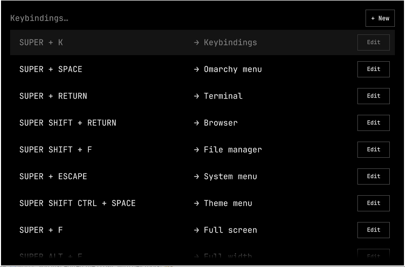

# Native keybinding editing proposal

This screenshot illustrates a local Omarchy 4.0.6-1 prototype that adds Edit buttons and a New action to the existing Super + K picker. It is a UI proposal, not a core implementation included in this branch.

The prototype reuses the stock selector and derives its edit/create dialogs and configuration helpers from [Astro Keybind Editor](https://github.com/astrofoundry/omarchy-keybind-editor) (MIT, copyright astrofoundry). The main app launcher remains the stock Omarchy menu. The screenshot contains only the picker, with no surrounding desktop.

